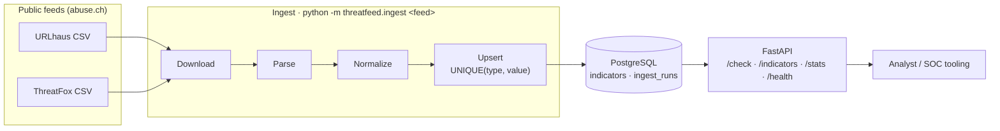

# ThreatFeed


> A small threat intelligence platform. It ingests public indicator-of-compromise (IoC) feeds,
> normalizes and deduplicates them into PostgreSQL, and answers one question over a REST API:
> **"Is this IP / domain / URL / hash known to be malicious? Who says so, and since when?"**

**Status:** phase 2 (applied security) complete; phase 3 (distributed) in progress
(scheduling, workers and full compose done; cache and rate limiting pending). See the
[roadmap](#roadmap).

## Why

Security teams rely on *threat feeds*: continuously updated lists of IoCs published by
organizations such as [abuse.ch](https://abuse.ch/). IPs of botnet command-and-control servers,
URLs currently distributing malware, hashes of known malicious files. Firewalls block them, SIEMs
alert on them, analysts look them up by hand. Consuming the raw feeds is painful, though:

- **Every feed speaks its own dialect.** Different columns, comment lines, casing, trailing dots.
- **They overlap.** The same indicator appears in several feeds. Without deduplication you cannot
  tell how many unique indicators you have, and you lose a valuable signal: independent sources agreeing.
- **Indicators expire.** IP addresses get reassigned. Blocking forever creates false positives,
  so every indicator needs a *first seen* and a *last seen*.
- **Provenance matters.** When something gets blocked, the first question is: who says it is
  malicious, and since when?

ThreatFeed aggregates several feeds into one normalized, deduplicated, queryable store that keeps
provenance and freshness for every indicator. It is strictly defensive: it consumes public data
and organizes it. It does not scan, attack, or analyze malware.

## How it works



1. **Ingest.** One ingestor per feed downloads and parses it (CSV, or a ZIP containing one),
   skipping comment lines, normalizes each indicator (lowercase scheme and host, no trailing dot,
   no default port or fragment) and upserts it. Every run is recorded in `ingest_runs` with
   counters and status.
2. **Deduplicate.** An indicator's identity is the pair `(type, value)`, enforced by a unique
   constraint. Re-ingesting never creates duplicates: it updates `last_seen` and appends the new
   source. Ingestion is idempotent, so a crashed or repeated run is always safe to re-run.
3. **Serve.** A FastAPI service answers lookups, lists indicators with pagination, reports
   totals per type and source, scores confidence from source agreement and freshness, and
   matches nginx access logs against the store.

## Data model

**`indicators`**

| Column | Type | Notes |
| --- | --- | --- |
| `id` | uuid | Primary key, `uuidv7()` by default (time-ordered) |
| `type` | enum | `ip`, `domain`, `url`, `hash_sha256`, `hash_md5` |
| `value` | text | Normalized form |
| `first_seen` | timestamptz | Earliest date any feed reported it |
| `last_seen` | timestamptz | Most recent date any feed still reports it |
| `raw` | jsonb | Latest original payload, kept for reprocessing |

Unique constraint on `(type, value)`. Deduplication happens in the database with an upsert
(`INSERT ... ON CONFLICT DO UPDATE`), not in application code. ThreatFox's `sha1_hash` IOCs are
skipped because the vocabulary is closed; they are counted in `rows_skipped`.

**`indicator_sources`**: provenance per feed, so "who says so" survives a feed that stops
reporting an indicator. Columns: `indicator_id` (FK, `ON DELETE CASCADE`), `feed`,
`first_seen`, `last_seen`; primary key `(indicator_id, feed)`. Rows are upserted, never deleted
implicitly: a truncated download must not wipe provenance, and the dumps are rolling windows
(90 days for URLhaus, 6 months for ThreatFox), so absence does not mean the indicator is clean.

**`ingest_runs`**: `feed`, `started_at`, `finished_at`, `status` (`running`, `succeeded`,
`failed`), `rows_read`, `rows_skipped`, `indicators_new`, `indicators_updated`, `error`. The
audit trail of every ingestion; the row is written as `running` before the feed is touched, so
a crash leaves evidence.

**`ip_enrichment`**: 1:1 with an IP indicator (`indicator_id` is PK and FK with
`ON DELETE CASCADE`). Columns: `country_code`, `country_name`, `asn`, `as_org`, `enriched_at`.
Filled at ingestion and by `python -m threatfeed.enrich`; absent for non-IP indicators and for
IPs without a GeoIP hit. Keeping it separate avoids four nullable columns on every domain, URL
and hash.

## API

| Endpoint | Purpose |
| --- | --- |
| `GET /check?value=...` | Is this indicator known? Returns type, sources, dates and confidence |
| `GET /indicators?type=&limit=&offset=` | Paginated listing, optionally filtered by type |
| `GET /stats` | Totals per type and per source |
| `POST /analyze/logs` | Match an nginx `combined` access log against the store |
| `GET /health` | Liveness check |

`/check` infers the type (IP, domain, URL, MD5 or SHA256) and normalizes the value with the same
rules used at ingestion; it returns **404** when the value is valid but unknown and **422** when it
cannot be classified. `/indicators` returns `{items, total, limit, offset}` (default 50, max 200,
newest first), and `/stats` returns `{total, by_type, by_source}` with every type present.

Both indicator endpoints include `confidence: {score, level, reasons}`: how many distinct feeds
report the indicator plus how fresh the latest report is. It is computed on read, never stored.
They also include `geo: {country_code, country_name, asn, as_org}` for enriched IP indicators,
and `null` for everything else.

### Log analysis

`POST /analyze/logs` takes a multipart file in nginx `combined` format and streams it line by
line, looking up observables in batches of 500 lines:

```bash
curl -F "file=@access.log" "http://localhost:8000/analyze/logs?max_matches=10"
```

It extracts the **client IP** and **absolute URLs** found in the request and the referer. An
origin-form path (`GET /x HTTP/1.1`) has no host, so it is ignored rather than guessed; use a log
format with `$host` if you need path matching. The response summarizes `lines_read`,
`lines_skipped`, `unique_indicators` and `truncated`, with one entry per indicator: `hits`,
`first_line`, `last_line`, `matched_on` and the full indicator including confidence. Uploads are
capped at 10 MB (413 above that) and at 100 matches by default (max 1000).

## Stack

| Layer | Choice | Why |
| --- | --- | --- |
| Web framework | FastAPI | Type-driven validation with Pydantic, OpenAPI for free, async-ready |
| ORM / migrations | SQLAlchemy 2 (sync) + Alembic | Explicit SQL model, versioned schema changes |
| Database | PostgreSQL 18 | `jsonb`, `timestamptz`, native upsert |
| GeoIP / ASN | `geoip2` + MMDB | Local lookups, no per-request network call; GeoLite2 or DB-IP Lite |
| Queue / scheduling | Celery + Redis | Scheduled ingestion, retries, one run per feed; Redis will also back the `/check` cache |
| Driver | psycopg 3 | Modern, actively maintained Postgres driver |
| Config | pydantic-settings | Typed settings from environment / `.env`, 12-factor style |
| Tooling | uv · pytest · ruff | Fast, reproducible installs; tests; lint + format in one tool |
| Local env | Docker Compose | One command to bring up the database, broker, API, worker and scheduler |

## Getting started

Requirements: [uv](https://docs.astral.sh/uv/) and Docker with Compose v2.

```bash
git clone https://github.com/RubenDelgadoPareja/threatfeed.git
cd threatfeed
cp .env.example .env                          # dev credentials + ABUSECH_AUTH_KEY (free)
docker compose up -d db redis                 # PostgreSQL + Redis
uv sync                                       # creates .venv and installs everything
uv run alembic upgrade head                   # apply migrations
uv run python -m threatfeed.ingest urlhaus    # URLhaus: ~60k URLs
uv run python -m threatfeed.ingest threatfox  # ThreatFox: ~150k IOCs of every type
uv run uvicorn threatfeed.main:app --reload   # API on http://localhost:8000 (docs at /docs)
```

To run the whole stack in containers instead:

```bash
docker compose up -d --build                  # db, redis, api, worker and beat
```

The API is on `http://localhost:8000`. Beat schedules URLhaus every 60 minutes and ThreatFox
daily at 00:30 UTC (the export quota resets at 00:00). Both are configurable in `.env` through
`URLHAUS_INTERVAL_MINUTES`, `THREATFOX_SCHEDULE_HOUR` and `THREATFOX_SCHEDULE_MINUTE`. The
worker and Beat share `.cache/` through a bind mount, so the ThreatFox ZIP and GeoIP files are
reused inside the containers. For local development you can run only the infrastructure and
start the worker and Beat yourself:

```bash
uv run celery -A threatfeed.celery_app worker --loglevel=INFO
uv run celery -A threatfeed.celery_app beat --loglevel=INFO
```

Manual task dispatch is useful for smoke tests:

```bash
uv run python -c "from threatfeed.tasks import ingest_feed; ingest_feed.delay('urlhaus', limit=10)"
```

Both abuse.ch feeds need a free key from [auth.abuse.ch](https://auth.abuse.ch/), set as
`ABUSECH_AUTH_KEY` in `.env` (`URLHAUS_AUTH_KEY` is still accepted as the old name). The key
travels in the URL path and is redacted from logs. `URLHAUS_EXPORT` selects the URLhaus file
(`recent.csv` by default); other exports are named in your abuse.ch account.

ThreatFox limits downloads to four times the export size per UTC day, counting partial
transfers. The full ZIP is cached in `.cache/threatfeed/` for the current UTC day, so repeated
runs reuse it; on a cache miss and a 429 the run fails with the reset time. Add `--limit N` to
ingest only the first N rows, and rely on the exit code: 0 if the run ended `succeeded`, 1 if it
ended `failed`.

GeoIP enrichment is optional. Download the MMDB files — [MaxMind GeoLite2](https://dev.maxmind.com/geoip/geolite2-free-geolocation-data)
or [DB-IP Lite](https://db-ip.com/) — set `GEOIP_COUNTRY_DB` and `GEOIP_ASN_DB` in `.env`
(relative paths such as `.cache/geoip/country.mmdb` work both locally and in the containers),
and backfill the IPs already stored:

```bash
uv run python -m threatfeed.enrich
```

New IPs are enriched during ingestion. The examples use DB-IP Lite (CC BY 4.0); GeoLite2 works
through the same reader and only changes the paths.

Today both ingestors run end to end, the distributed stack schedules them through Celery, the
API serves `/check`, `/indicators`, `/stats`, `/analyze/logs` and `/health`, and IPs carry
country and ASN. Remaining in phase 3: the Redis cache for `/check` and rate limiting.

Development:

```bash
uv run pytest
uv run ruff check . && uv run ruff format --check .
```

## Project layout

```
src/threatfeed/
├── main.py             # FastAPI app and router wiring
├── config.py           # settings (pydantic-settings, .env)
├── celery_app.py       # Celery app and Beat schedule
├── tasks.py            # ingest_feed task
├── classification.py   # infer the type of an incoming value and normalize it
├── normalize.py        # URL canonicalization shared by ingestion and lookups
├── logs.py             # nginx combined log parser
├── geoip.py            # MMDB readers (GeoLite2 / DB-IP Lite)
├── enrichment.py       # persistence of geo rows
├── db/                 # declarative base, engine/session, Alembic migrations
├── models/             # SQLAlchemy models
├── schemas/            # Pydantic response schemas
├── ingest/             # BaseIngestor, runner, lock, CSV/HTTP helpers, feeds
├── enrich/             # GeoIP backfill CLI
└── api/                # routers
tests/
├── fixtures/           # real CSV excerpts
└── conftest.py         # test database, transaction rollback, seeded indicators
docs/agents/            # conventions for coding agents: issue tracker, triage labels, domain docs
```

## Roadmap

- [x] **Phase 1: backend.**
  - [x] Scaffold: `src/` layout, Docker Compose with PostgreSQL 18, typed settings, Alembic wired
    to the app settings, FastAPI app with lifespan and `GET /health`, pytest + ruff.
  - [x] Models and first migration (`indicators`, `indicator_sources`, `ingest_runs`).
  - [x] URLhaus ingestor (`python -m threatfeed.ingest urlhaus`).
  - [x] REST API: `/check`, `/indicators`, `/stats`.
  - [x] ThreatFox ingestor on a shared `BaseIngestor`.
  - [x] Tests: parser fixtures from real CSV excerpts, API against a test database.
- [x] **Phase 2: applied security.**
  - [x] Multi-source confidence score on `/check` and `/indicators`.
  - [x] `POST /analyze/logs` to match an nginx access log against the indicators, parsed as a
    stream.
  - [x] GeoIP / ASN enrichment (MaxMind GeoLite2 or DB-IP Lite).
- [ ] **Phase 3: distributed.**
  - [x] Celery + Redis scheduled ingestion with parallel workers.
  - [x] Retries with exponential backoff.
  - [x] Idempotent tasks: upsert plus a PostgreSQL advisory lock per feed.
  - [x] Full Docker Compose: database, Redis, API, worker and Beat.
  - [ ] Rate limiting.
  - [ ] Redis cache for `/check` with invalidation after each ingestion.

## Design decisions

Short version; detailed notes will grow with the project.

- **Deduplicate in the database, not in Python.** A unique constraint plus upsert is atomic and
  race-free even with several workers ingesting at once.
- **Provenance in a join table, not a `jsonb` array.** `indicator_sources` records when each feed
  reported an indicator, so "who says so" can expire and independent sources can be counted.
  A jsonb list of names would keep claiming a feed forever after it stops reporting.
- **UUIDv7 primary keys.** Time-ordered, so inserts keep index locality unlike uuid4, and
  generated by PostgreSQL 18 (`uuidv7()`) rather than duplicated in application code.
- **Commit per batch, not per file.** 500 rows per transaction keeps locks and WAL bounded; a
  crash leaves committed batches plus a `failed` run, and the idempotent upsert makes re-running
  converge. All-or-nothing would mean one bad row discards an entire download.
- **Known unsupported types are skipped; malformed rows fail the run.** ThreatFox's `sha1_hash`
  IOCs do not fit the closed vocabulary, so they are counted in `rows_skipped` without tripping
  the guard. More than 10% malformed rows still fail the run: that is a format change.
- **The ThreatFox ZIP is cached for the UTC day.** The provider allows four times the file size
  per day, counting partial transfers, so a fresh cache avoids burning quota on repeated runs.
- **Redis is the broker, not the source of truth.** No result backend: run state lives in
  `ingest_runs`. `acks_late`, one prefetch and a two-hour visibility timeout keep a slow
  ThreatFox run from being delivered twice.
- **One advisory lock per feed.** The CLI and the Celery task share it; PostgreSQL releases it
  when the connection closes, so a dead worker cannot leave a feed locked. The upsert is still
  the final guarantee of idempotency.
- **Retries are classified.** Transient network and database errors retry with exponential
  backoff; 429s, auth failures and malformed feeds do not, because retrying them only burns the
  provider's quota or repeats the same mistake.
- **One `BaseIngestor`, two feeds.** Download and row mapping differ; batching, upsert,
  provenance, counters and the malformed-row guard are shared rather than copied.
- **`/check` takes `?value=` and classifies it.** URLs contain `/` and `?`, so a path parameter
  would force double encoding; and the caller should not have to declare the type. The value is
  normalized with the same code as ingestion, or lookups miss on a trailing dot or default port.
- **Malformed input is 422; a valid but unknown indicator is 404.** Keeping the two cases
  distinguishable matters when debugging why a lookup "did not find anything".
- **Confidence is computed, not stored.** One feed scores 40, two 70, three or more 90; a report
  from the last 7 days adds 10, from the last 30 adds 5, capped at 100. It counts *feeds*, not
  providers, because both current feeds are abuse.ch; cross-provider weighting waits for a third,
  genuinely independent source.
- **Log matching is conservative.** Only the client IP and absolute URLs in the request/referer
  are looked up; an origin-form path has no host, and inventing one would create false positives.
  Observables are queried in batches of 500 lines, and uploads are capped at 10 MB.
- **GeoIP lives in its own optional table.** `ip_enrichment` is 1:1 with IP indicators; non-IPs
  and IPs without a hit have no row. It is filled at ingestion and by an idempotent backfill, so
  refreshing the MMDB is a re-run rather than a migration.
- **Synchronous SQLAlchemy.** FastAPI runs plain `def` endpoints in a threadpool, so sync database
  calls do not block the event loop, and the phase 3 Celery workers are synchronous anyway.
  Async would add complexity without a measurable gain at this scale.
- **Keep the raw payload.** If a parser bug is found, indicators can be reprocessed from `raw`
  without hitting the feeds again.
- **One `.env` for everything.** Docker Compose and the application read the same `POSTGRES_*`
  variables, so there is a single source of truth for local configuration.

## Glossary

| Term | Meaning |
| --- | --- |
| IoC | Indicator of compromise: an observable (IP, domain, URL, file hash) tied to malicious activity |
| Feed | A continuously updated list of IoCs, usually published as CSV or JSON |
| C2 | Command-and-control server from which an attacker issues orders to infected machines |
| Botnet | A set of infected machines controlled by the same C2 |
| False positive | Flagging something legitimate as malicious |
| Normalization | Reducing each indicator to a canonical form so that equal indicators compare equal |
| Confidence | How strongly the stored sources agree that an indicator is malicious, weighted by freshness |
| ASN | Autonomous System Number: the network that announces an IP range |

---

Built by [Rubén Delgado Pareja](https://github.com/RubenDelgadoPareja) to go deep on Python
backend engineering, threat intelligence and distributed systems.
