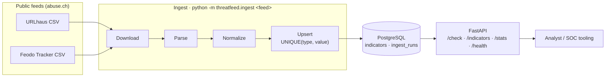

# ThreatFeed


> A small threat intelligence platform. It ingests public indicator-of-compromise (IoC) feeds,
> normalizes and deduplicates them into PostgreSQL, and answers one question over a REST API:
> **"Is this IP / domain / URL / hash known to be malicious? Who says so, and since when?"**

**Status:** phase 1 (backend) in progress. See the [roadmap](#roadmap).

## Why

Security teams rely on *threat feeds*: continuously updated lists of IoCs published by
organizations such as [abuse.ch](https://abuse.ch/). IPs of botnet command-and-control servers,
URLs currently distributing malware, hashes of known malicious files. Firewalls block them, SIEMs
alert on them, analysts look them up by hand. Consuming the raw feeds is painful, though:

- **Every feed speaks its own dialect.** Different columns, comment lines, casing, trailing dots.
- **They overlap.** The same indicator appears in several feeds. Without deduplication you cannot
  tell how many unique indicators you have, and you lose a valuable signal: independent sources agreeing.
- **Indicators expire.** IP addresses get reassigned. Blocking forever creates false positives,
  so every indicator needs a *first seen* and a *last seen*.
- **Provenance matters.** When something gets blocked, the first question is: who says it is
  malicious, and since when?

ThreatFeed aggregates several feeds into one normalized, deduplicated, queryable store that keeps
provenance and freshness for every indicator. It is strictly defensive: it consumes public data
and organizes it. It does not scan, attack, or analyze malware.

## How it works



1. **Ingest.** One ingestor per feed downloads the CSV, parses it (skipping comment lines),
   normalizes each indicator (lowercase, no trailing dots, canonical URLs) and upserts it.
   Every run is recorded in `ingest_runs` with counters and status.
2. **Deduplicate.** An indicator's identity is the pair `(type, value)`, enforced by a unique
   constraint. Re-ingesting never creates duplicates: it updates `last_seen` and appends the new
   source. Ingestion is idempotent, so a crashed or repeated run is always safe to re-run.
3. **Serve.** A FastAPI service answers lookups, lists indicators with pagination and reports
   totals per type and source.

## Data model

**`indicators`**

| Column | Type | Notes |
| --- | --- | --- |
| `id` | uuid | Primary key, `uuidv7()` by default (time-ordered) |
| `type` | enum | `ip`, `domain`, `url`, `hash_sha256`, `hash_md5` |
| `value` | text | Normalized form |
| `first_seen` | timestamptz | Earliest date any feed reported it |
| `last_seen` | timestamptz | Most recent date any feed still reports it |
| `raw` | jsonb | Latest original payload, kept for reprocessing |

Unique constraint on `(type, value)`. Deduplication happens in the database with an upsert
(`INSERT ... ON CONFLICT DO UPDATE`), not in application code.

**`indicator_sources`**: provenance per feed, so "who says so" survives a feed that stops
reporting an indicator. Columns: `indicator_id` (FK, `ON DELETE CASCADE`), `feed`,
`first_seen`, `last_seen`; primary key `(indicator_id, feed)`. Rows are upserted, never deleted
implicitly: a truncated download must not wipe provenance, and URLhaus' dump is a rolling
90-day window, so absence does not mean the indicator is clean.

**`ingest_runs`**: `feed`, `started_at`, `finished_at`, `status` (`running`, `succeeded`,
`failed`), `rows_read`, `rows_skipped`, `indicators_new`, `indicators_updated`, `error`. The
audit trail of every ingestion; the row is written as `running` before the feed is touched, so
a crash leaves evidence.

## API

| Endpoint | Purpose |
| --- | --- |
| `GET /check/{value}` | Is this indicator known? Returns type, sources, first and last seen |
| `GET /indicators?type=&limit=&offset=` | Paginated listing, optionally filtered by type |
| `GET /stats` | Totals per type and per source |
| `GET /health` | Liveness check |

## Stack

| Layer | Choice | Why |
| --- | --- | --- |
| Web framework | FastAPI | Type-driven validation with Pydantic, OpenAPI for free, async-ready |
| ORM / migrations | SQLAlchemy 2 (sync) + Alembic | Explicit SQL model, versioned schema changes |
| Database | PostgreSQL 18 | `jsonb`, `timestamptz`, native upsert |
| Driver | psycopg 3 | Modern, actively maintained Postgres driver |
| Config | pydantic-settings | Typed settings from environment / `.env`, 12-factor style |
| Tooling | uv · pytest · ruff | Fast, reproducible installs; tests; lint + format in one tool |
| Local env | Docker Compose | One command to bring up the database (and, later, workers) |

## Getting started

Requirements: [uv](https://docs.astral.sh/uv/) and Docker with Compose v2.

```bash
git clone https://github.com/RubenDelgadoPareja/threatfeed.git
cd threatfeed
cp .env.example .env                         # local credentials; dev defaults are fine
docker compose up -d db                      # PostgreSQL with a readiness healthcheck
uv sync                                      # creates .venv and installs everything
uv run alembic upgrade head                  # apply migrations
uv run python -m threatfeed.ingest urlhaus   # first ingestion
uv run uvicorn threatfeed.main:app --reload  # API on http://localhost:8000 (docs at /docs)
```

Today the schema is migrated and the API serves `GET /health`; the ingestor and the remaining
endpoints land with the next [roadmap](#roadmap) items.

Development:

```bash
uv run pytest
uv run ruff check . && uv run ruff format --check .
```

## Project layout

Target layout; directories appear as the roadmap advances.

```
src/threatfeed/
├── main.py       # FastAPI application
├── config.py     # settings (pydantic-settings, .env)
├── db/           # declarative base, engine/session, Alembic migrations
├── models/       # SQLAlchemy models
├── schemas/      # Pydantic schemas (API in/out)
├── ingest/       # one ingestor per feed
└── api/          # routers
tests/
docs/agents/      # conventions for coding agents: issue tracker, triage labels, domain docs
```

## Roadmap

- [ ] **Phase 1: backend.**
  - [x] Scaffold: `src/` layout, Docker Compose with PostgreSQL 18, typed settings, Alembic wired
    to the app settings, FastAPI app with lifespan and `GET /health`, pytest + ruff.
  - [x] Models and first migration (`indicators`, `indicator_sources`, `ingest_runs`).
  - [ ] URLhaus ingestor (`python -m threatfeed.ingest urlhaus`).
  - [ ] REST API: `/check`, `/indicators`, `/stats`.
  - [ ] Feodo Tracker ingestor on a shared `BaseIngestor`.
  - [ ] Tests: parser fixtures from real CSV excerpts, API against a test database.
- [ ] **Phase 2: applied security.** GeoIP / ASN enrichment (MaxMind GeoLite2) · multi-source
  confidence score · `POST /analyze/logs` to match an nginx access log against the indicators,
  parsed as a stream.
- [ ] **Phase 3: distributed.** Celery + Redis scheduled ingestion with parallel workers ·
  retries with exponential backoff · rate limiting · idempotent tasks · Redis cache for `/check`
  with invalidation after each ingestion · full Docker Compose.

## Design decisions

Short version; detailed notes will grow with the project.

- **Deduplicate in the database, not in Python.** A unique constraint plus upsert is atomic and
  race-free even with several workers ingesting at once.
- **Provenance in a join table, not a `jsonb` array.** `indicator_sources` records when each feed
  reported an indicator, so "who says so" can expire and independent sources can be counted.
  A jsonb list of names would keep claiming a feed forever after it stops reporting.
- **UUIDv7 primary keys.** Time-ordered, so inserts keep index locality unlike uuid4, and
  generated by PostgreSQL 18 (`uuidv7()`) rather than duplicated in application code.
- **Synchronous SQLAlchemy.** FastAPI runs plain `def` endpoints in a threadpool, so sync database
  calls do not block the event loop, and the phase 3 Celery workers are synchronous anyway.
  Async would add complexity without a measurable gain at this scale.
- **Keep the raw payload.** If a parser bug is found, indicators can be reprocessed from `raw`
  without hitting the feeds again.
- **One `.env` for everything.** Docker Compose and the application read the same `POSTGRES_*`
  variables, so there is a single source of truth for local configuration.

## Glossary

| Term | Meaning |
| --- | --- |
| IoC | Indicator of compromise: an observable (IP, domain, URL, file hash) tied to malicious activity |
| Feed | A continuously updated list of IoCs, usually published as CSV or JSON |
| C2 | Command-and-control server from which an attacker issues orders to infected machines |
| Botnet | A set of infected machines controlled by the same C2 |
| False positive | Flagging something legitimate as malicious |
| Normalization | Reducing each indicator to a canonical form so that equal indicators compare equal |

---

Built by [Rubén Delgado Pareja](https://github.com/RubenDelgadoPareja) to go deep on Python
backend engineering, threat intelligence and distributed systems.
